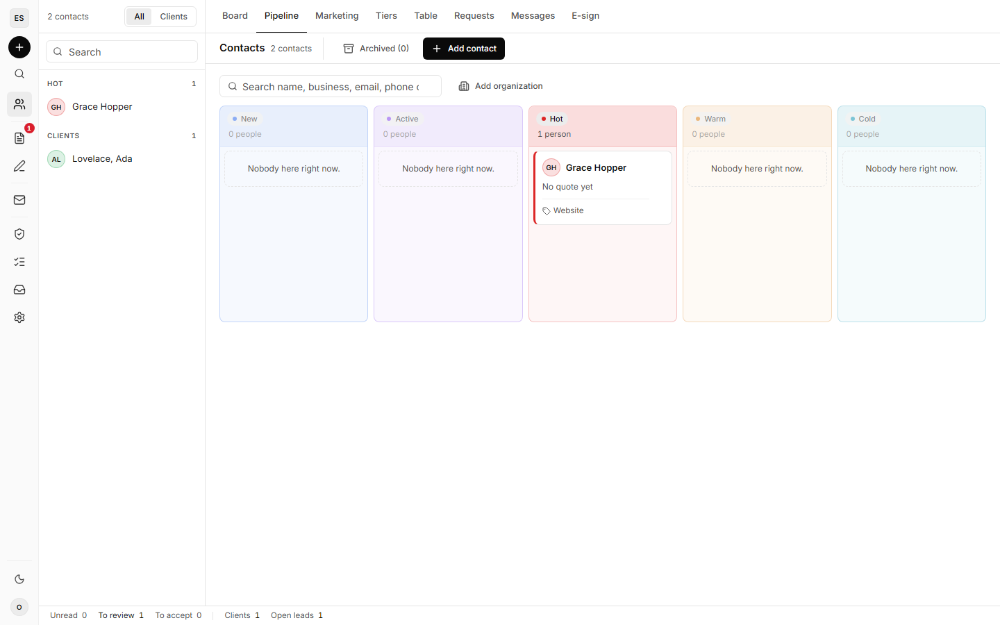
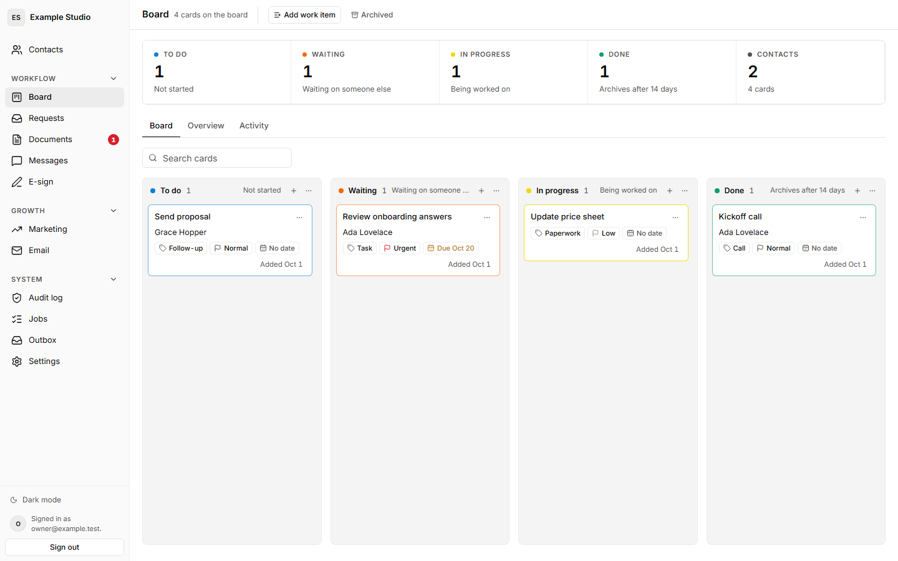
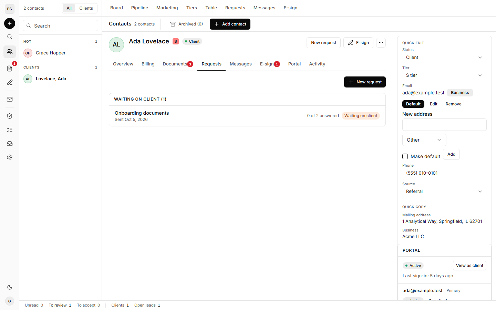
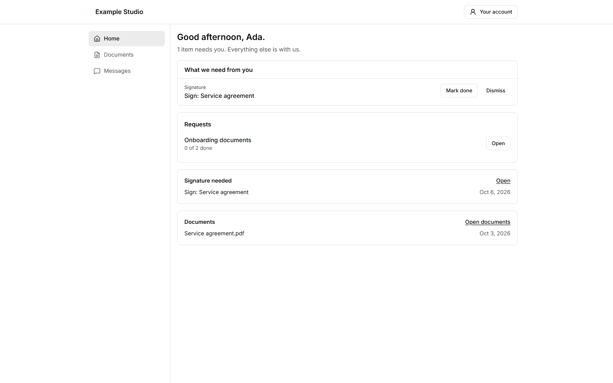
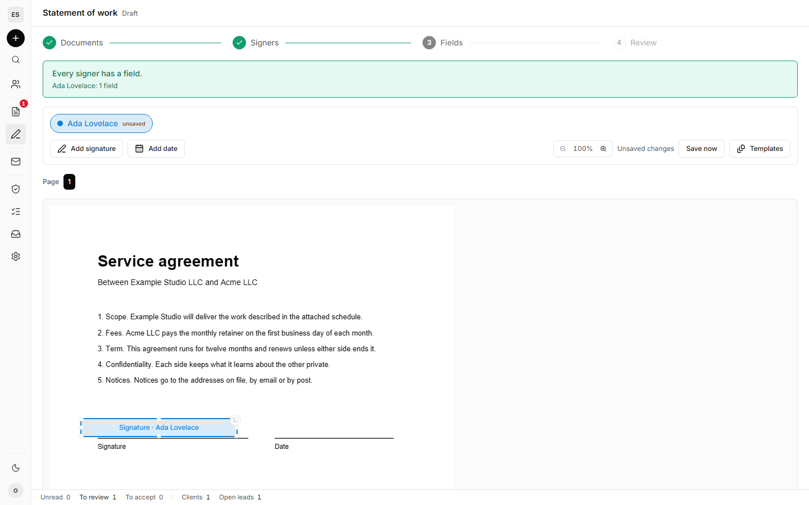

A self-hosted CRM and client-workflow suite for a single business, built on React and
Supabase. One owner runs it; clients get a secure portal. It is extracted from a CRM that has
run a real client practice in production, and it is MIT licensed.



## What it does

- **Contacts and pipeline**: contacts, businesses they own, notes, service quotes and upsells,
  client tiers and reversible archiving.
- **Client portal**: invitations, a client home, profile.
- **Documents**: upload, preview, annotate and share, encrypted at rest.
- **Secure messages**: a client's message is end-to-end encrypted in their browser to the
  owner's key; the owner's replies are stored as plain text. Messages are deleted 7 days after
  they are read.
- **Requests**: send a client a list of documents and questions, with reminders; a request
  closes itself once every answer is accepted.
- **E-signature**: place fields, send, sign, and verify an executed PDF against tampering.
- **Work board**: a Kanban board of work items with configurable stages.
- **Group email**: email a chosen group of contacts, with an unsubscribe link in every message.
- **Marketing**: leads and won clients by month and by source, revenue goals and ad spend.
- **Lead intake**: a keyed endpoint another system posts new leads to.
- **MCP connector**: an OAuth-protected MCP server so an AI assistant can work the CRM.
- **Control center**: names, branding, lead sources, services and other pick-lists are data the
  owner edits, not code.

| The work board | A contact record |
| --- | --- |
|  |  |

| The client portal | The e-signature composer |
| --- | --- |
|  |  |

## Documentation

- [Setup](setup.md): from a fresh clone to a running install, step by step.
- [Configuration](configuration.md): every environment variable and function secret, required
  or optional, and what stops working without it.
- [Features](features.md): what the owner and clients can do, domain by domain.
- [Architecture](architecture.md): the feature registry, the edge layer, the job runner, the
  outbound adapter and the migrations.
- [Contributing](https://github.com/timlegcpa/open-crm/blob/main/CONTRIBUTING.md) and
  [Security](https://github.com/timlegcpa/open-crm/blob/main/SECURITY.md) (how to report a
  vulnerability).

## Running it

You need Node 22 and a Supabase project; the free plan is enough, and nothing runs in Docker.
From a fresh clone of [the repository](https://github.com/timlegcpa/open-crm):

```bash
npm ci
npx supabase login
npx supabase link --project-ref <your-project-ref>
npx supabase db push
npx supabase config push
npm run dev:bootstrap
npx supabase secrets set --env-file supabase/functions/.env
npx supabase functions deploy --use-api
npm run schedules:install
npm run dev
```

[Setup](setup.md) walks through each step and what the bootstrap does.

## Security model

- Row-level security on every table, with explicit grants rather than inherited defaults.
- The owner is resolved from a single identity row plus an MFA session check. A role claim in
  a token grants nothing on its own.
- A client is a portal account bound to one contact and reads its own record through narrow
  functions.
- Rate limits fail closed. The audit log cannot be updated, deleted or truncated. The anonymous
  role can reach no table at all.

## Author

Built and maintained by Timothy LeGendre, CPA, of
[Timothy LeGendre CPA LLC](https://timcpa.com/).
